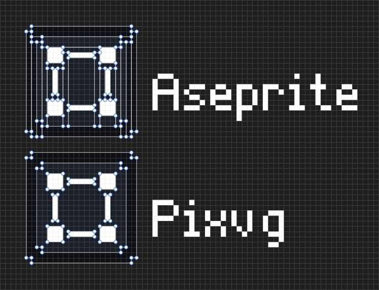

# PixVG

<p align="center">
  
</p>

## About

**PixVG** is a small **CLI utility** for tracing pixel-style art/sprites/logos/icons to SVG. It optimizes the resulting
SVG so that every connected color region *(connected in terms of Von Neumann neighborhood or 4-neighborhood)* is
separated from others.

It's intended to be used in **pixel-style (web) design**, because it works very well with duotone logos, icons, and
other elements where you can find fairly large areas of connected colors. You can easily colorize
duotone SVGs later. Scaling pixel-style graphics is quite a problem, but SVG is easily scalable.

**Note:** For input with many colors and a large number of small pixel clusters, PixVG will produce fairly
heavy SVG files. It is **NOT** a magical tool.

Hope it helps you!

## Features

- **Pixel-perfect tracing**: Converts pixel art to optimized SVG paths
- **Color region separation**: Each connected color region becomes a separate path
- **Cluster detection**: Automatically separates disconnected regions of the same color
- **Path optimization**: Reduces redundant nodes for cleaner SVG output
- **Scalable output**: Apply scaling factor to generated SVGs

## Installation

**PixVG** is distributed as a standalone executable built with PyInstaller.

### Download Pre-built Binary

Download the latest release from the [Releases](https://github.com/your-repo/pixvg/releases) page.

## Usage

```bash
pixvg.exe [OPTIONS]
```

### Options

| Option                             | Type     | Default | Description                                 |
|------------------------------------|----------|---------|---------------------------------------------|
| `-i`, `--input`                    | Path     | `./in`  | Input directory containing PNG files        |
| `-o`, `--output`                   | Path     | `./out` | Output directory for SVG files              |
| `-s`, `--scale`                    | Int (≥1) | `1`     | Scale factor for output SVGs                |
| `-f`, `--force`                    | Flag     | `False` | Force processing large images/many colors   |
| `--split-regions/--remain-regions` | Flag     | `True`  | Split color regions into connected clusters |

## How It Works

1. **Color Region Extraction**: Analyzes the input PNG and identifies unique colors
2. **Cluster Detection**: Separates disconnected regions of the same color
3. **Edge Tracing**: Traces the boundary of each color cluster
4. **Path Optimization**: Removes redundant nodes from traced paths
5. **SVG Generation**: Constructs optimized SVG with separate paths per cluster

## Safety

- **Max image size**: 512×512 pixels (bypass with `--force`)
- **Max colors**: 128 unique colors (bypass with `--force`)
- **Supported formats**: PNG only
- **Transparency**: Only fully opaque pixels are traced

## Examples

### 1. Comparison with Aseprite

<p align="center">
  
</p>
